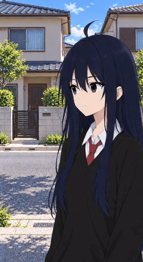

# Shotsmith

**Режиссура AI-сцен из терминала: референсы → кадры A/B → анимация → готовый ролик.**

Shotsmith объединяет подготовку визуальных сцен и работу с собственным GPU-сервером в одном консольном приложении. Вместо отдельных ручных операций в нескольких инструментах — проект с референсами, опорными кадрами, версиями и последовательностью видеосцен.



[Смотреть демонстрационный ролик в MP4](docs/media/two-scenes-demo.mp4)

В демонстрации — две связанные сцены с одной героиней. Движение создаётся моделью между начальным и конечным кадром; это не переход с растворением между двумя картинками. Пример получен через ComfyUI на арендованной RTX 4090. Раскадровка и визуальная приёмка остаются творческой частью процесса.

## Возможности

- **Терминальный интерфейс:** поле ввода, slash-команды, история, автодополнение и прогресс установки.
- **Свой GPU по SSH:** подключение сервера, подтверждение host key, диагностика и управляемый локальный туннель к ComfyUI.
- **Установка окружения:** закреплённая версия ComfyUI, профили моделей, проверка размера и SHA256, частичные загрузки и восстановление после обрыва. До двух моделей скачиваются параллельно.
- **Проекты и референсы:** описание сцен, изображения персонажей, существ, окружения и стиля; отдельные состояния начала и конца сцены.
- **Опорные кадры:** Qwen Image Edit 2511, покадровые референсы, версии, локальная HTML-раскадровка и одобрение точного изображения перед зависимой генерацией.
- **Видео A → B:** Wan 2.2 I2V 14B high/low-noise, описание движения, сохранение параметров и входов, проверка полученного MP4.
- **Сборка сцен:** локальный монтаж принятых клипов через FFmpeg с сохранением порядка и manifest результата.
- **Контроль исполнения:** явная отправка заданий, сохранённый intent, восстановление по prompt/history и защита от повторной отправки при неопределённом ответе.

## Быстрый старт

Нужны Windows, PowerShell 5.1 или новее, Python 3.12, OpenSSH Client. Для полноэкранного интерфейса нужен .NET 10 SDK; для локальной проверки и сборки видео — FFmpeg в `PATH` или переменной `SHOTSMITH_FFMPEG`. GPU нужен на удалённом Linux-сервере, а не обязательно на пользовательском компьютере.

```powershell
git clone https://github.com/Bb-soil/Shotsmith.git
Set-Location Shotsmith

py -3.12 -m venv .venv
.\.venv\Scripts\python.exe -m pip install -r requirements.txt

dotnet restore ui/Shotsmith/Shotsmith.csproj --locked-mode
dotnet publish ui/Shotsmith/Shotsmith.csproj -c Release -r win-x64 --self-contained true -o data/app/shotsmith-complete

.\shotsmith.ps1
```

Без сборки .NET доступна обычная консольная оболочка и команды `avs.ps1`. Локальная диагностика не требует аренды:

```powershell
.\avs.ps1 video doctor
.\avs.ps1 project create
```

## Работа в приложении

```text
/new          создать проект и импортировать референсы
/projects     выбрать сохранённый проект
/edit         редактировать проект
/prepare      проверить и подготовить план
/connect      подключить GPU-сервер по SSH
/profile      выбрать bundle или qwen
/inspect      проверить окружение
/install      предварительный просмотр установки
/install --execute
/status       состояние подключения и установки
/resume       продолжить существующую установку
/frames       сгенерировать и экспортировать опорные кадры
/approve      одобрить точную версию кадра
/storyboard   открыть экспорт раскадровки
/video        создать и выполнить видеозадание
/assemble     собрать принятые сцены
/outputs      сохранённые результаты
/help         справка
```

Команды с генерацией требуют отдельного подтверждения. Сначала проверяется раскадровка, затем запускается анимация: дефектный опорный кадр не стоит переносить в дорогостоящий видеорендер.

## Модели и окружение

- **Кадры:** Qwen Image Edit 2511, text encoder Qwen 2.5 VL и Qwen Image VAE.
- **Анимация:** Wan 2.2 I2V 14B, два FP8-эксперта high/low-noise, UMT5 и Wan VAE.
- **Исполнение:** ComfyUI с закреплённым commit, API workflows и проверкой совместимости классов и входов.
- **Интерфейс:** C# / Terminal.Gui; проект, установка и задания — Python; вход — PowerShell.

Объединённый профиль содержит примерно **61.2 GiB весов**; установщик рассчитывает дополнительный запас диска. Практические эксперименты проводились на RTX 4090 24 GB и RTX 5090 32 GB. Вместимость и скорость зависят от выбранной сцены и окружения. Профили находятся в `config/i1/`, графы — в `workflows/`.

## Как устроен проект

- `ui/Shotsmith/` — полноэкранный терминальный интерфейс.
- `scripts/i1/` — SSH-подключения, установка, состояние и восстановление.
- `scripts/kf2/` — создание и подготовка пользовательского проекта.
- `scripts/kf1/` — генерация кадров, версии, одобрения и раскадровка.
- `scripts/video/` — видеопланы, исполнение, проверка MP4 и сборка.
- `anime_studio/` — общие компоненты транспорта и workflow.
- `tests/` — тесты и публичные fixtures.
- `docs/` — инструкция и демонстрационные материалы.

## Статус

Shotsmith — развивающийся авторский проект для производства коротких AI-сцен. Подключение, установка, генерация кадров и анимация применялись в реальных GPU-экспериментах; сквозная оболочка объединяет эти инструменты. Визуальная приёмка обязательна: модель может менять лицо, анатомию, композицию и детали окружения.

Текущий видеопуть работает без звука; смешивание разных FPS/геометрии при сборке блокируется. GPU-сервер пользователь выбирает и оплачивает самостоятельно. `/disconnect` и выход из приложения **не завершают аренду**.

Это локальный инструмент для автора, а не многопользовательский облачный сервис. В репозиторий не включены веса моделей, ключи, рабочие подключения, пользовательские проекты и внутренние журналы разработки.

## Проверки

Код сопровождается unit, contract и offline integration тестами. Они проверяют состояние заданий, восстановление, привязку входов и файлов, работу с изображениями и видео. Такие тесты не заменяют художественную оценку результата на GPU. В публичной копии не распространяются приватные исторические evidence и fixtures с данными реальных аренд.

Быстрая offline-проверка основных команд и видеопайплайна (для видеопроверок установите FFmpeg):

```powershell
.\.venv\Scripts\python.exe -m pytest tests/test_video_app.py tests/test_console_shell.py -q -o addopts=
```

На подготовленной публичной копии: **38 passed**. Полный внутренний архив тестов связан с историческими проектами и evidence; команда выше проверяет переносимый публичный набор.

## Права и сторонние компоненты

Исходный код опубликован для знакомства с проектом и портфолио. Отдельная open-source лицензия на авторский код пока не предоставлена; публикация не означает разрешения на его коммерческое перераспространение. Сторонние компоненты и модели регулируются собственными лицензиями. См. [THIRD_PARTY_NOTICES.md](THIRD_PARTY_NOTICES.md).
