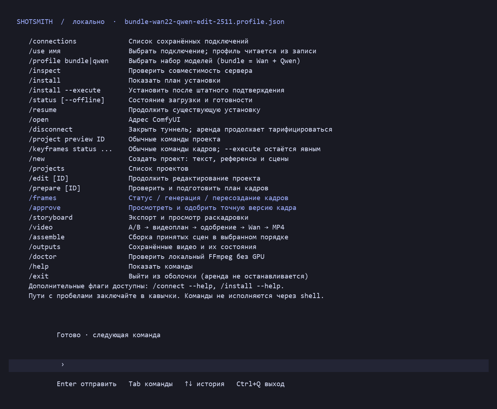

# Shotsmith

**Direct AI video scenes from your terminal: references → A/B keyframes → animation → assembled clips.**

[English](README.md) · [Русский](README.ru.md)

Shotsmith brings reference-based scene planning, a remote GPU installer, keyframe generation and video assembly into one terminal application. Keep your inputs, frame versions, approvals and video jobs together while using your own GPU server.


[Watch the two-scene demo in MP4](docs/media/two-scenes-demo.mp4)

The demo follows one character across two shots. Each shot is generated between a start frame and an end frame using Wan 2.2 through ComfyUI on an RTX 4090. The animation is model-generated, rather than a crossfade between still images. The demo has no audio.

## The terminal application



*Rendered from an actual offline application screen dump. The current application interface is in Russian; documentation is available in English and Russian. This view shows commands, not a simulated GPU run.*

## What it does

- **Terminal workspace:** command input, history, completion and installation progress.
- **Bring your GPU:** SSH connections, host-key verification, environment inspection and an owned localhost tunnel to ComfyUI.
- **Install the runtime:** pinned ComfyUI and model profiles, size/SHA256 checks, partial downloads, recovery and up to two concurrent model downloads.
- **Organize a project:** import character, creature, environment and style references; define separate start and end states for each scene.
- **Generate keyframes:** Qwen Image Edit 2511, per-frame reference selection, version history, an HTML storyboard and exact-image approval before dependent frames.
- **Animate A → B:** Wan 2.2 I2V 14B high/low-noise experts, motion instructions and saved inputs and execution parameters.
- **Assemble scenes:** combine accepted clips locally with FFmpeg and retain a result manifest.
- **Recover deliberately:** durable submit intent, prompt/history tracking and no automatic duplicate submission when an earlier request has an uncertain outcome.

## Try it without renting a GPU

You can explore project authoring and local diagnostics before connecting a server. The published demo and terminal view above require no installation.

Use **Windows, PowerShell 5.1 or later, Python 3.12 and OpenSSH Client**. Building the fullscreen TUI requires **.NET 10 SDK**. FFmpeg is needed for local video validation and assembly; put it in `PATH` or set `SHOTSMITH_FFMPEG`.

```powershell
git clone https://github.com/Bb-soil/Shotsmith.git
Set-Location Shotsmith
py -3.12 -m venv .venv
.\.venv\Scripts\python.exe -m pip install -r requirements.txt

# Local project authoring; no GPU or cloud account required.
.\avs.ps1 project create
.\avs.ps1 video doctor
```

`video doctor` reports a local blocker if FFmpeg is missing; it does not rent a server or download software.

### Fullscreen terminal UI

```powershell
dotnet restore ui/Shotsmith/Shotsmith.csproj --locked-mode
dotnet publish ui/Shotsmith/Shotsmith.csproj -c Release -r win-x64 --self-contained true -o data/app/shotsmith-complete
.\shotsmith.ps1
```

Without the .NET build, the Python console shell and the `avs.ps1` subcommands remain available.

## A typical production session

```text
/new                  Create a project and import references
/projects             Select a saved project
/edit                 Edit scene states and references
/prepare              Validate and compile the execution plan
/connect              Connect your Linux GPU server over SSH
/profile bundle       Select Wan + Qwen (or /profile qwen for keyframes)
/inspect              Inspect the server environment
/install              Preview the installation
/install --execute    Install after explicit confirmation
/status               Inspect installation and connection state
/resume               Resume the existing installation attempt
/frames               Generate, retry or export keyframes
/approve              Approve an exact frame version
/storyboard           Export the local storyboard
/video                Create, approve and execute a video job
/assemble             Assemble accepted clips
/outputs              Find saved results
/help                 Command reference
```

Review the storyboard before spending GPU time on animation. Installation and generation require explicit confirmation. `/disconnect` and exiting Shotsmith **do not cancel your GPU rental**.

## Models and hardware

- **Keyframes:** Qwen Image Edit 2511, Qwen 2.5 VL text encoder and Qwen Image VAE.
- **Video:** Wan 2.2 I2V 14B FP8 high/low-noise experts, UMT5 and Wan VAE.
- **Runtime:** ComfyUI with pinned revisions, API graphs and compatibility checks.
- **Client:** C# / Terminal.Gui, Python orchestration and PowerShell entry points.

The combined profile downloads approximately **61.2 GiB of weights**, plus installation overhead and disk reserve. The keyframe-only profile avoids downloading the Wan video models. Experiments have used RTX 4090 24 GB and RTX 5090 32 GB servers; actual memory use and speed depend on the scene and runtime. Model files and GPU rental are not included.

## Repository guide

- `ui/Shotsmith/` — fullscreen TUI.
- `scripts/i1/` — SSH connections, installation and recovery.
- `scripts/kf2/` — project authoring and plan preparation.
- `scripts/kf1/` — keyframe generation, versions, approvals and storyboards.
- `scripts/video/` — video jobs, validation and local assembly.
- `anime_studio/` — shared runtime and workflow components.
- `config/i1/` and `workflows/` — pinned profiles and API graphs.

Internal stage identifiers and `avs.ps1` remain for compatibility with existing plans and scripts. Use `shotsmith.ps1` as the application entry point. See [architecture](docs/ARCHITECTURE.md).

## Development and feedback

This is an actively developed authoring tool. SSH installation, keyframe generation and animation have been exercised in real GPU experiments. Visual review remains part of the workflow: a model may change identity, anatomy or composition. The current video path is silent; assembly rejects mismatched frame rates or geometry. Shotsmith is a local client, not a hosted multi-user service.

Feedback on installation, error messages, reference handling and scene continuity is welcome through [GitHub Issues](https://github.com/Bb-soil/Shotsmith/issues). Include the command, expected behavior and a redacted error message; do not upload keys, tokens or private connection state.

### Public smoke tests

With FFmpeg installed:

```powershell
.\.venv\Scripts\python.exe -m pytest tests/test_video_app.py tests/test_console_shell.py -q -o addopts=
```

This public smoke set passed **38 tests** during publication preparation. Historical tests may depend on private evidence and project fixtures that are intentionally not distributed. Tests verify execution behavior, not artistic quality.

## License

Shotsmith's original application code and documentation are licensed under **Apache-2.0**. See [LICENSE](LICENSE) and [NOTICE](NOTICE).

External runtimes, models, dependencies and upstream-derived workflow material retain their own license terms. Model weights and FFmpeg binaries are not bundled. Demo media is provided to showcase the project and is not covered by the application-code license. See [third-party notices](THIRD_PARTY_NOTICES.md).
